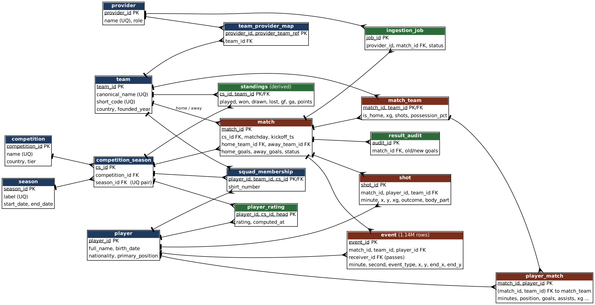

# Portfolio 1: Database Design and Modelling

**Case study:** The Data XI (football analytics warehouse). The full case-study statement is at the top of the
[root README](../README.md).

## Case study statement
The Data XI is a football analytics warehouse built on publicly available football match data. It’s used by the ingestion pipeline (writes), the public API and website (reads) and analysts (heavy read queries), each with its own role. It stores competitions, seasons, teams, players, matches, line-ups, shots and detailed match statistics for every single match. The main operations include but are not limited to:
1. Ingesting match data from several data providers.
2. Reconciling match, player and club ids
3. Serving match pages, player stats and leaderboards.
4. Running Analysis Queries.

For the purposes of this case-study, the data is simulated and NOT real production data.

## What is here

| File | Purpose |
|---|---|
| `sql/01_schema.sql` | All 17 tables with primary keys, foreign keys, `UNIQUE` and `CHECK` constraints |
| `diagrams/er_diagram.png` (+ `.svg`, `.dot`) | Entity-relationship diagram (generated with Graphviz from `er_diagram.dot`) |
| `normalization.md` | From a flat provider export to 1NF, 2NF, 3NF and BCNF, and the deliberate denormalisations |
| `sql/02_load_data.sql` | Loads the simulated CSVs with `\copy`, then `VACUUM (ANALYZE)` |
| `sql/03_roles_and_security.sql` | Three roles: `api_reader`, `analyst`, `pipeline_writer` (least privilege) |
| `sql/04_integrity_checks.sql` | Four cross-table consistency checks that must return zero rows |
| `sql/05_constraint_tests.sql` | Nine statements that must be rejected (proof the constraints work) |
| `../data-generator/generate_data.py` | Seeded generator of the simulated data (seed 8103) |

## ER diagram



Colours: blue = reference/dimension tables, brown = fact tables, green = derived and operational tables.

## Design decisions (and why)

1. **`competition_season` as the "edition" table.** A match belongs to one competition in one season. Instead of repeating
   both on every row, `match.cs_id` points to a single edition row.
2. **Provider reconciliation is part of the model.** The real platform merges several data providers. Each team has a
   different id at each provider, so `team_provider_map(provider_id, provider_team_ref) -> team_id` resolves them to one
   canonical `team_id`. `UNIQUE (provider_id, team_id)` stops one team having two ids at the same provider.
3. **A composite foreign key instead of a trigger.** `player_match(match_id, team_id)` references `match_team(match_id,
   team_id)`, so a player can only be attached to a team that actually played that match.
4. **Constraints that state business rules.** For example `match_score_status`: a finished match must have both goals
   and an unfinished match must have neither. `standings_points_ok` says `points = 3*won + drawn`, which Portfolio 3 uses
   to catch a buggy script.
5. **Keys are plain `integer`/`bigint` ids assigned by the pipeline** (not `serial`), so a re-load of the same match
   lands on the same primary key instead of creating a duplicate row.
6. **Denormalisation is deliberate and checked** (see `normalization.md` section 5): the score on `match`, `team_id` on
   `shot`/`event`, `is_home` on `match_team`, and the whole `standings` table.

## How it was tested

```bash
psql -d dataxi -f sql/01_schema.sql
psql -d dataxi -v csv=/path/to/data-generator/csv -f sql/02_load_data.sql
psql -d dataxi -f sql/03_roles_and_security.sql
psql -d dataxi -f sql/04_integrity_checks.sql      # expect four "(0 rows)"
```

Load result (`results/load_output.txt`): 1,140 matches, 25,080 player appearances, 31,659 shots, 1,140,000 events. Every
`CHECK`, foreign key and `UNIQUE` constraint accepted the data, and the four integrity checks return **0 rows**.

**Constraint tests** (`sql/05_constraint_tests.sql`, output in `results/constraint_tests_output.txt`): nine statements
that must all be rejected, covering CHECK constraints, the composite foreign key, UNIQUE keys, a delete blocked by a
foreign key, and a write attempted as the read-only `api_reader` role. All nine were rejected with the expected error.

## Evidence that the checks are useful

On the first load, check C2 (shot goals vs player goals) returned **398 rows**: the generator gave some players more goals
than shots. No single `CHECK` can express a rule across two tables, so only the integrity query could find it. The
generator was fixed and the check now returns zero rows.

## Limitations

* `event.team_id` is not forced to equal the player's team in that match (no declarative way without a trigger). It is
  checked by the generator and would be a trigger in production.
* Data is simulated: the shapes and sizes are realistic, the football is not (scores come from a Poisson model).
